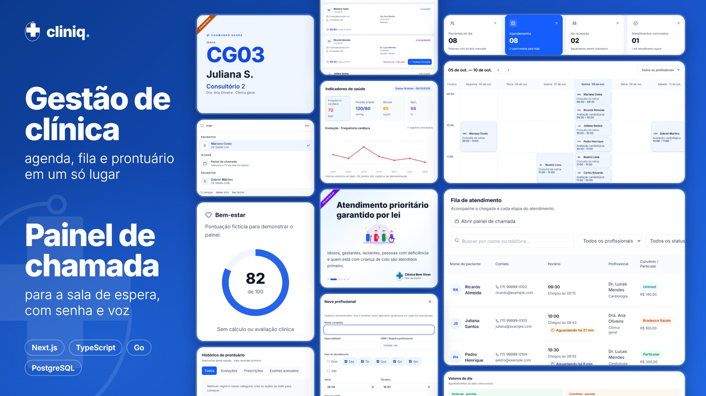
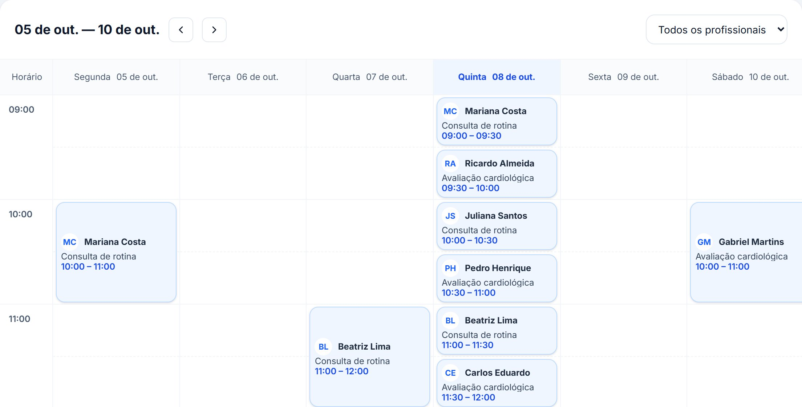
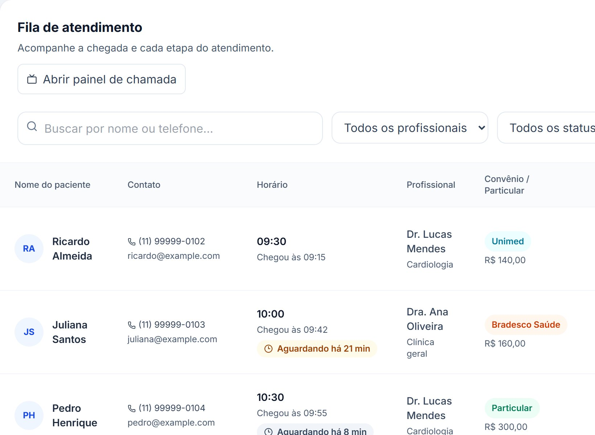
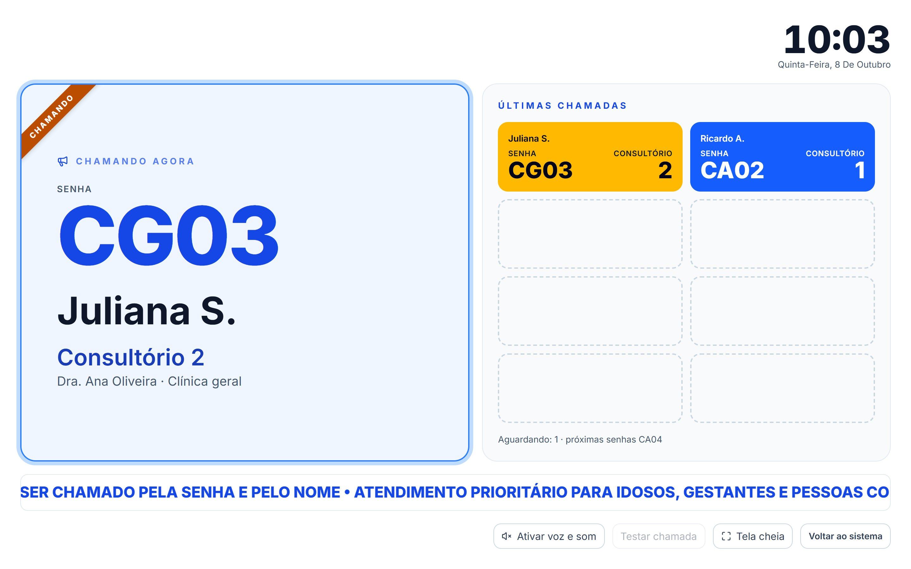
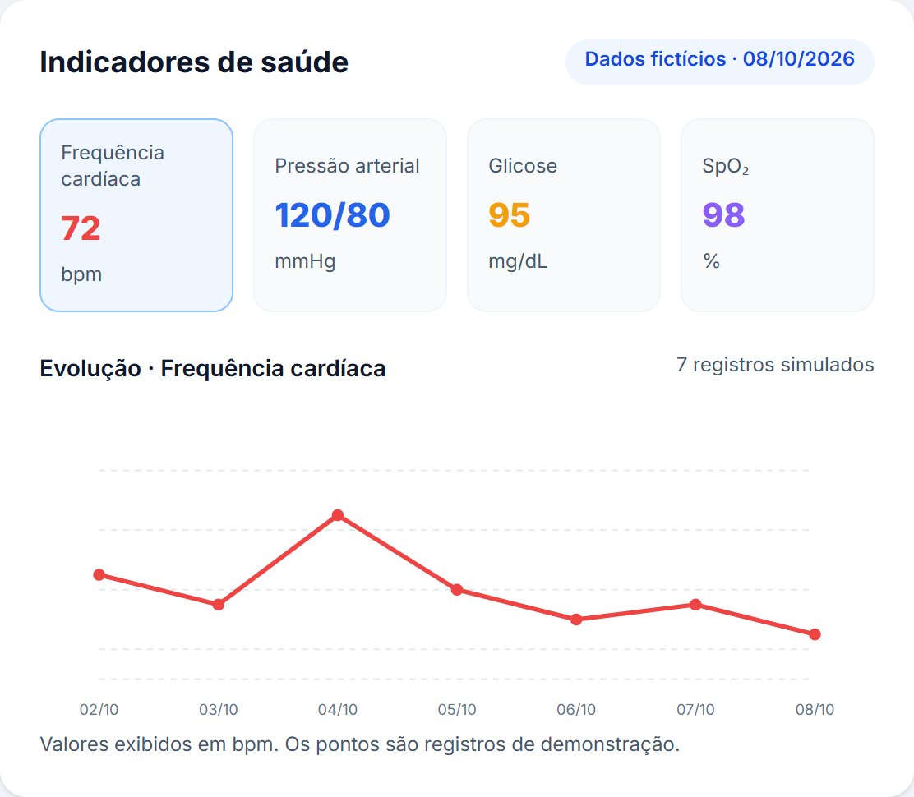

<h1 align="center">🏥 Cliniq · Projeto Clínica</h1>

<p align="center"><em>Sistema de agendamento e gestão para clínicas, com agenda semanal e fila de atendimento.</em></p>

<p align="center">
  
</p>

<p align="center">

  <a href="#-sobre">Sobre</a> · <a href="#-funcionalidades">Funcionalidades</a> · <a href="#-tecnologias">Tecnologias</a> · <a href="#-como-rodar">Como rodar</a> · <a href="#-contato">Contato</a>
</p>

<p align="center">
  
  
</p>

---

## 💻 Sobre

Sistema de gestão para clínicas que reúne agenda, fila de atendimento e cadastro de pacientes em um só lugar, com um modo de demonstração interativa.

> **Tipo:** projeto · **Ano:** 2026

## ✨ Funcionalidades

- Agenda em grade semanal, por profissional.
- Fila de atendimento com status: aguardando, em atendimento e concluído.
- Ficha editável do paciente.
- Visão geral do dia, com valores de consultas particulares e de convênios.
- Busca rápida (Ctrl+K) por paciente ou tela, e tempo de espera ao vivo na fila.
- Painel de chamada para a sala de espera, com senha, consultório e voz.

## 🎯 Dores que resolve

- Conflito de horários e reservas simultâneas para o mesmo profissional.
- Recepção sem uma visão clara de quem já chegou e de quem está em atendimento.
- Fichas de pacientes difíceis de consultar e de atualizar.

## 💼 Tecnologias


| Tecnologia | Para que usei |
| --- | --- |
| **Next.js** | Interface e rotas (App Router). |
| **TypeScript** | Tipagem das entidades do sistema. |
| **Tailwind CSS** | Estilo, com tokens e componentes reutilizáveis (design system). |
| **Go** | API em camadas: handlers, services e repository. |
| **PostgreSQL** | Banco de dados, com transações que evitam reservas duplicadas. |

## 📸 Telas

<table>
  <tr>
    <td width="25%" align="center" valign="top"><br /><sub>Agenda semanal</sub></td>
    <td width="25%" align="center" valign="top"><br /><sub>Fila com espera ao vivo</sub></td>
    <td width="25%" align="center" valign="top"><br /><sub>Painel de chamada</sub></td>
    <td width="25%" align="center" valign="top"><br /><sub>Indicadores de saúde</sub></td>
  </tr>
</table>

## 🚀 Como rodar

Precisa do Node.js 22.9+ e do npm. Para o sistema completo, também do Go 1.25+ e de um PostgreSQL.

```bash
git clone https://github.com/MuriloRocha-01/Projeto-clinica.git
cd Projeto-clinica
```

**Só a interface (modo demonstração, sem back-end):**

```bash
cd frontend
npm install
npm run dev        # http://localhost:3000
```

**Sistema completo:**

```bash
npm --prefix frontend install
# configure backend/.env a partir de backend/.env.example (DATABASE_URL e PORT)
npm run dev:backend     # API em http://localhost:8080
npm run dev:frontend    # interface em http://localhost:3000
```

Testes das regras da agenda, fila e painel: `cd frontend && node --test tests/*.mts`.
O banco, as rotas da API e as notificações estão detalhados na [documentação técnica](#-documentação-técnica), mais abaixo.

## 🗂 Estrutura do projeto

```text
frontend/              Next.js (App Router) + TypeScript + Tailwind
├─ src/app/            /dashboard, /dashboard/agenda, /dashboard/pacientes, /dashboard/configuracoes e /painel
├─ src/components/     ui (design system), dashboard, calendar, patients, settings, panel e layout
├─ src/services/       regras puras: agenda, fila, tempo de espera e painel de chamada
└─ tests/              testes dessas regras
backend/               API em Go (handlers → services → repository) + PostgreSQL
├─ cmd/                api, worker (notificações) e db
├─ internal/           handlers, services, repository, models, database e notifications
└─ migrations/ e schema.sql
```

## 🧭 Próximos passos

- [ ] Arrastar e soltar consultas na agenda, já validando conflito de horário
- [ ] Avisos com "desfazer" depois das ações
- [ ] Modo escuro
- [ ] Autenticação (o perfil de hoje é de demonstração)
- [ ] Painel de chamada em outro computador: hoje ele só acompanha janelas do mesmo navegador e exigiria o servidor enviar as chamadas ao vivo

## 📖 Documentação técnica

<details>
<summary>Abrir a documentação técnica (conteúdo do README anterior, com os títulos um nível abaixo)</summary>

## Agendamento Clínica

Next.js/TypeScript no frontend e Go/pgx/PostgreSQL no backend.

A API segue as camadas de `AGENTS.md`: `cmd` configura as dependências; `internal/handlers` trata HTTP e payloads; `internal/services` contém regras de expediente, conflito, transição e agrupamento da fila; `internal/repository` executa SQL e transações. As validações dos serviços são executadas dentro da transação, sob o bloqueio do profissional, preservando a proteção contra reservas simultâneas.

### Ambiente

Node.js 22.9+, npm e Go 1.25+. O arquivo local backend/.env configura DATABASE_URL e PORT; npm run dev:backend o carrega automaticamente. Variáveis já definidas no terminal têm prioridade. A senha PostgreSQL fica somente nesse arquivo ignorado pelo Git. O frontend usa frontend/.env.local.

```powershell
npm run dev:backend
# Em outro terminal:
npm run dev:frontend
```

API: http://localhost:8080. Frontend: http://localhost:3000.
As rotas também aceitam o prefixo /api e são encaminhadas pelo Next.js.

### Banco

O schema completo está em backend/schema.sql. As quatro tabelas foram aplicadas ao projeto Supabase configurado: clinics, professionals, clients e appointments, com FKs, índices e RLS habilitado sem policies públicas.

Para instalar o schema em OUTRO banco novo:

```powershell
npm run db -- -file schema.sql
```

Esse comando cria as tabelas e não deve ser repetido em um banco onde elas já existem. Em caso de erro a transação inteira é revertida. O arquivo backend/migrations/001_initial.sql é o protótipo anterior e não é usado pela API atual.

Alternativamente, para desenvolvimento local, copie backend/.env.example para backend/.env, defina POSTGRES_PASSWORD com uma senha exclusiva e substitua [YOUR-PASSWORD] em DATABASE_URL pela mesma senha (codificada para URL, se contiver caracteres especiais). Execute `docker compose --env-file backend/.env up -d --wait` para criar o PostgreSQL e aplicar backend/schema.sql na primeira inicialização do volume. Volumes criados com o schema anterior precisam de migração; Compose não os atualiza automaticamente.

A conexão remota usa TLS e limita o pool a cinco conexões. Se a rede não suportar IPv6, copie a URL de Connect → Session pooler no painel Supabase, incluindo o host e usuário exatos. Veja a [documentação de conexão](https://supabase.com/docs/guides/database/connecting-to-postgres).

### Cadastros

| Método | Rota | Dados |
| --- | --- | --- |
| POST | /clinics | name, cnpj (14 dígitos com verificadores válidos), address |
| GET | /clinics | Lista clínicas |
| POST | /professionals | clinic_id, name, specialty, availability |
| GET | /professionals?clinic_id=1 | Lista profissionais da clínica |
| POST | /clients | clinic_id, name, phone, email, birth_date |
| GET | /clients?clinic_id=1 | Lista pacientes da clínica |
| GET | /api/health | Verifica conexão com o banco |

Cadastre a clínica primeiro. Profissionais e pacientes devem pertencer a uma clínica existente. Nascimento usa YYYY-MM-DD, sem data futura. E-mail é único por clínica e normalizado para minúsculas.

Expediente de profissional usa uma lista como esta (0 = domingo, 6 = sábado):

```json
{
  "clinic_id": 1,
  "name": "Ana",
  "specialty": "Cardiologia",
  "availability": [
    {"weekday": 1, "start": "09:00", "end": "12:00"},
    {"weekday": 1, "start": "14:00", "end": "18:00"}
  ]
}
```

Intervalos devem usar HH:mm, início menor que fim e não podem se sobrepor no mesmo dia. Expediente vazio não permite agendar.

### Agendamentos

```http
POST /appointments
Content-Type: application/json

{
  "clinic_id": 1,
  "professional_id": 1,
  "client_id": 1,
  "start_time": "2026-10-12T09:00:00-03:00",
  "end_time": "2026-10-12T10:00:00-03:00",
  "notes": "Primeira consulta"
}
```

Retorna 201 com ID, status agendado e horários. Notas são opcionais. O POST não aceita status: novas reservas começam agendadas.

```http
GET /appointments?professional_id=1&date=2026-10-12

PATCH /appointments/1/status
Content-Type: application/json

{"status":"chegou"}
```

Listagem retorna 200 com array JSON ordenado por início, incluindo cancelados. date considera o fuso da agenda, e inclui intervalos que intersectam o dia. GET e PATCH também aceitam clinic_id opcional para conferir a clínica.

Fluxo operacional: `agendado → chegou → em_atendimento → concluido`. Um agendado também pode virar `faltou` ou `cancelado`; um cliente na recepção pode ser cancelado. `concluido` e `faltou` são finais. Um cancelado pode voltar a `agendado`, passando novamente pela validação de expediente e conflito. Transições inválidas retornam 409. Repetir o status atual é idempotente.

#### Fila de recepção

As ações abaixo não precisam de corpo JSON e usam as mesmas transições e transações do PATCH de status:

```http
PATCH /appointments/1/check-in
PATCH /appointments/1/call
PATCH /appointments/1/complete
```

Retornam o agendamento atualizado (200), com `chegou`/`check_in_at`, `em_atendimento`/`called_at` e `concluido`/`completed_at`, respectivamente. Também aceitam `?clinic_id=1` para conferir a clínica. Pular uma etapa retorna 409. `na_recepcao` ainda é aceito pelo PATCH de status como alias de `chegou`; respostas usam `chegou`.

```http
GET /queue?professional_id=1&date=2026-10-12
```

Retorna `{ "arrived": [], "upcoming": [] }`. Cada item inclui o agendamento e `client_name`/`client_phone`. `arrived` contém apenas `chegou`; `upcoming` contém apenas `agendado`. Chamados, concluídos, faltosos e cancelados não aparecem nessas listas. Sem `date`, usa o dia atual no fuso da agenda. `clinic_id` é opcional e, quando enviado, precisa corresponder à clínica do profissional.

O POST de agendamentos aceita `priority` entre 0 e 100, padrão 0. Números maiores vêm primeiro; em empate, os presentes seguem a chegada e os previstos seguem o horário marcado. ID resolve o último empate. Não há regra automática de prioridade. O script `backend/sql/queue_actions.sql` já foi aplicado ao Supabase configurado, convertendo o status antigo e adicionando a coluna/índice; em outros bancos com a versão anterior, aplique uma única vez.

```http
GET /appointments/queue?clinic_id=1
GET /appointments/queue?clinic_id=1&professional_id=1&date=2026-10-12
```

O endpoint anterior `/appointments/queue` continua retornando um array apenas de pacientes que chegaram, ordenado por prioridade e chegada. Quando o profissional chama o cliente, ele sai dessa fila; continua visível na agenda com status `em_atendimento`.

WebSockets e SSE são opcionais e não foram implementados neste módulo.

`check_in_at`, `called_at` e `completed_at` são `timestamptz` opcionais preenchidos pelo servidor PostgreSQL nas respectivas transições. O cliente da API não informa esses timestamps. Repetir um status preserva os valores. Reativar um cancelado zera os timestamps do ciclo anterior. Não há histórico de ciclos nesta etapa.

O script incremental `backend/sql/appointment_workflow.sql` já foi aplicado ao Supabase configurado e converteu `pendente`/`confirmado` para `agendado`. Em outro banco com o schema anterior, aplique uma única vez com `npm run db -- -file sql/appointment_workflow.sql`. Registros antigos concluídos não recebem timestamps inventados: os novos campos ficam nulos.

A validação usa start_time < novo_fim AND end_time > novo_inicio. Intervalos adjacentes são permitidos. Todos os status exceto cancelado bloqueiam o horário. Criação e alteração de status usam transação READ COMMITTED, bloqueando a linha do profissional com SELECT FOR UPDATE antes da consulta. Isso impede reservas simultâneas sobrepostas pela API. Escritas diretas no banco não passam por essa validação. Referência: [bloqueios PostgreSQL](https://www.postgresql.org/docs/current/explicit-locking.html).

A reserva precisa caber integralmente em um intervalo de expediente, no dia permitido. Não pode atravessar pausa ou meia-noite. O fuso padrão é America/Sao_Paulo, configurável por APPOINTMENT_TIMEZONE. Envie horários RFC3339 com offset ou Z; o banco usa timestamptz.

Erros: 400 para entrada inválida; 404 para profissional/paciente/agendamento inexistente ou de outra clínica; 409 para conflito/duplicidade; 415 para Content-Type incorreto; 422 para reserva fora do expediente. O corpo é limitado a 1 MiB.

### Verificação

```powershell
go -C backend test ./...
go -C backend vet ./...
npm run build:backend
npm run lint
npm run build:frontend
```

TEST_DATABASE_URL habilita a integração PostgreSQL:

```powershell
$env:TEST_DATABASE_URL = $env:DATABASE_URL
go -C backend test ./internal/handlers -run TestPostgresEndpoints -v -count=1
```

O teste usa um schema isolado e remove somente esse schema. Cobre cadastros, horários, conflitos, cancelamento, reativação, filtro do dia, vínculos entre clínicas e duas reservas concorrentes. Sem TEST_DATABASE_URL o teste é explicitamente pulado.

A API ainda não tem autenticação/autorização de acesso por clínica. RLS protege a Data API pública, mas o backend usa conexão PostgreSQL privilegiada. Feriados, exceções, remarcação e edição de expediente ainda não foram implementados.

O npm audit inicial apontou cinco alertas de severidade alta nas dependências de desenvolvimento do ESLint, registrados na configuração inicial. Revise-os ao atualizar dependências.


### Notificações com Evolution API (módulo 4)

O processo `backend/cmd/worker` é independente da API. Execute `npm run dev:worker` em outro terminal. Para um lote único: `npm run dev:worker -- -once`.

Configure em `backend/.env`:

```dotenv
REMINDERS_ENABLED=true
REMINDER_MODE=two_hours
REMINDER_INTERVAL=5m
REMINDER_CONCURRENCY=4
EVOLUTION_API_URL=https://sua-evolution.example.com
EVOLUTION_API_KEY=sua-chave
EVOLUTION_INSTANCE=clinica
WHATSAPP_WEBHOOK_SECRET=um-segredo-longo-e-aleatorio
```

`two_hours` busca os agendamentos futuros nas próximas duas horas; `next_day` busca o dia seguinte no fuso `APPOINTMENT_TIMEZONE`. Apenas `agendado` e ainda sem lembrete são elegíveis. O worker usa ticker, channels e WaitGroup; reserva lotes com `FOR UPDATE SKIP LOCKED` e uma concessão de 10 minutos, permitindo processos simultâneos. Faz até cinco tentativas com intervalo crescente. `reminder_sent` significa que a Evolution aceitou o envio, não que o paciente leu a mensagem.

Para um banco existente que já recebeu os módulos de fila, aplique uma vez `npm run db -- -file sql/notifications.sql`. O Supabase deste projeto já recebeu essa alteração. Bancos novos usam `backend/schema.sql`.

O envio usa `POST /message/sendText/{instance}`, cabeçalho `apikey` e JSON `{ "number": "5511999999999", "text": "..." }`. O ID `key.id` retornado é registrado em `reminder_message_id`.

Configure o webhook na Evolution usando `POST /webhook/set/{instance}` com:

```json
{
  "webhook": {
    "enabled": true,
    "url": "https://sua-api.example.com/webhook/whatsapp",
    "byEvents": false,
    "base64": false,
    "headers": { "X-Webhook-Token": "o-mesmo-segredo-do-backend" },
    "events": ["MESSAGES_UPSERT"]
  }
}
```

O endereço deve ser acessível pela Evolution. Reinicie a API após configurar instância/segredo. O paciente deve usar **Responder** no lembrete e digitar `1` (confirmar) ou `2` (cancelar). O webhook verifica segredo, instância, telefone e ID da mensagem citada. Mensagens sem citação, grupos e eventos enviados pela própria instância são ignorados. Repetir a mesma transição é idempotente. Confirmados continuam na agenda e podem fazer check-in.

Se o processo cair entre o envio e a gravação no banco, um lembrete pode ser reenviado após a concessão expirar. A Evolution não fornece aqui garantia de envio exatamente uma vez. Falhas esgotadas permanecem com `reminder_sent=false` e `reminder_attempts=5` para inspeção operacional. O worker fica desativado até as credenciais da Evolution serem preenchidas; os testes usam um gateway HTTP simulado, sem enviar mensagens reais.

Contrato baseado no [DTO oficial de mensagens](https://github.com/EvolutionAPI/evolution-api/blob/main/src/api/dto/sendMessage.dto.ts) e no [controlador oficial de webhooks](https://github.com/EvolutionAPI/evolution-api/blob/main/src/api/integrations/event/webhook/webhook.controller.ts).

### Arquivos privados

Mantenha senhas e tokens somente nos arquivos .env locais, ignorados pelo Git. O .env.example deve conter apenas campos vazios ou placeholders. Não versione dados reais de pacientes, capturas de tela com dados reais, exportações do banco, backups ou chaves privadas. Os arquivos SQL de schema e migrations fazem parte do código e devem continuar versionados.

Antes de publicar, revise os arquivos com git status e o conteúdo preparado com git diff --cached. O .gitignore não remove arquivos já rastreados nem limpa o histórico; se uma credencial real já foi publicada, revogue-a e substitua-a no serviço de origem.

### PEP demonstrativo

Rotas: `/dashboard`, `/dashboard/agenda`, `/dashboard/pacientes` e `/dashboard/pacientes/[id]`. A listagem reúne pacientes únicos da demonstração em todas as datas. Nomes na fila e nos detalhes abrem o prontuário. As rotas anteriores redirecionam para as novas.

O PEP permite evoluções com templates SOAP/retorno, prescrições em rascunho e anexos locais. Dados ficam em memória durante a navegação e são perdidos ao recarregar. Use somente dados fictícios. Não há gravação clínica no PostgreSQL, autenticação do autor, assinatura digital ou emissão de receitas.

Anexos aceitam PDF e DICOM Part 10 com cabeçalho DICM, até 20 MB por arquivo e 100 MB por sessão. A validação de cabeçalho não substitui inspeção de conteúdo no futuro servidor. PDF possui prévia local; DICOM exige visualizador externo após download. Nenhum arquivo é enviado ao servidor. Teste de validação: `node --experimental-strip-types frontend/tests/pep.test.mts`.

</details>

## 📬 Contato

Disponível para freelas e novas oportunidades, **#OpenToWork** 🚀  
📧 [murilorochadelima.10@gmail.com](mailto:murilorochadelima.10@gmail.com) · 💼 [LinkedIn](https://www.linkedin.com/in/murilo-rocha-6706a41aa/) · 🐙 [GitHub](https://github.com/MuriloRocha-01) · 🌐 [Portfólio](https://oficial-portifolio-six.vercel.app)

---

<p align="center">Feito com 💙 por <a href="https://github.com/MuriloRocha-01">Murilo Rocha</a></p>
