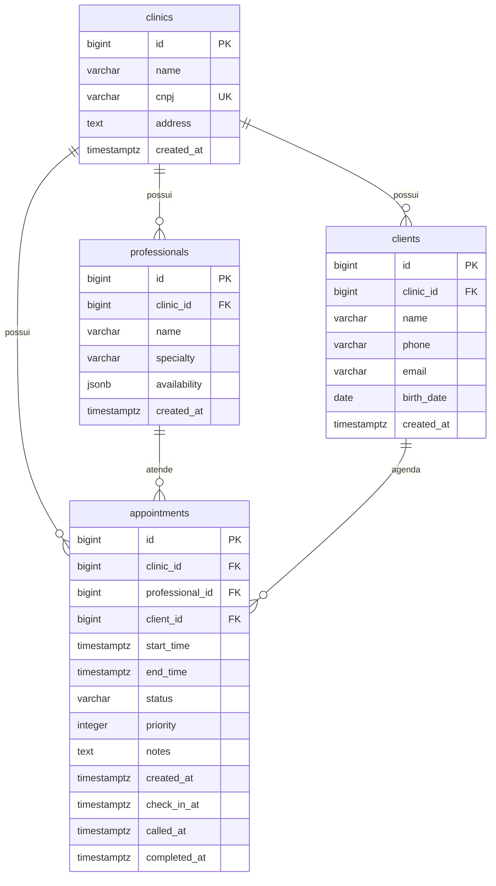

# Modelagem do banco

Uma clínica possui vários profissionais e pacientes. Cada cadastro pertence a uma única clínica por `clinic_id` obrigatório. A mesma pessoa pode ter cadastros separados em clínicas diferentes.



- CNPJ: único, 14 dígitos sem pontuação. A API deve validar os dígitos verificadores. Este primeiro formato considera CNPJ numérico.
- Endereço: texto único nesta etapa.
- Telefone: campo único para telefone/WhatsApp, sem assumir que todo número tem WhatsApp.
- E-mail de paciente: em minúsculas, único dentro de cada clínica. A mesma pessoa pode ser cadastrada em outra clínica.
- Data de nascimento: `date`, sem horário ou fuso. A API deve rejeitar datas futuras.
- Horários de profissionais: JSON com dia da semana e intervalos locais. Domingo é 0 e sábado é 6; os intervalos podem representar turnos separados. A API deve validar `HH:mm`, início menor que fim e ausência de sobreposição no mesmo dia. Listas vazias representam disponibilidade ainda não configurada.

```json
[
  {"weekday": 1, "start": "08:00", "end": "12:00"},
  {"weekday": 1, "start": "14:00", "end": "18:00"},
  {"weekday": 3, "start": "08:00", "end": "12:00"}
]
```

O SQL completo está em `schema.sql` e foi aplicado ao Supabase após verificar que as quatro tabelas não existiam. A API está alinhada a esses campos. O script serve para criar um banco novo; não é uma migration incremental para tabelas existentes.

Chaves estrangeiras impedem cadastros vinculados a clínicas inexistentes. `ON DELETE RESTRICT` impede excluir uma clínica com profissionais ou pacientes. Os índices atendem consultas por clínica. RLS está habilitado sem policies para impedir acesso pela Data API pública; o usuário PostgreSQL privilegiado usado pelo backend pode ignorar RLS.

`clinic_id` organiza os dados, mas não implementa autorização: a futura autenticação deve determinar a clínica permitida e aplicar esse filtro nas consultas. Horários são recorrências semanais; feriados e exceções não fazem parte deste modelo.

## Agendamentos

`appointments` relaciona uma clínica, um profissional e um paciente. As FKs compostas garantem que profissional e paciente pertençam à clínica informada. O ID usa `bigint identity`, seguindo o padrão das demais tabelas.

Início e fim usam `timestamptz` para representar instantes; envie datas com offset, por exemplo `2026-10-08T14:00:00-03:00`. O término deve ser posterior ao início. O status padrão é `agendado`; os valores aceitos são `agendado`, `chegou`, `em_atendimento`, `concluido`, `faltou` e `cancelado`. Observações são opcionais.

`check_in_at` registra a chegada; `called_at`, a chamada; `completed_at`, a conclusão. São preenchidos automaticamente pela API via relógio do PostgreSQL e permanecem nulos até o respectivo evento. Restrições verificam a ordem cronológica quando preenchidos. A fila deriva de `appointments`, sem tabela auxiliar: apenas `chegou` no dia consultado, por prioridade decrescente e ordem de chegada. A coluna `priority` vai de 0 a 100, padrão 0; o novo `/queue` também lista agendados separadamente. O índice parcial atende essa consulta. O fluxo operacional e as transições permitidas estão no README.

Índices atendem consultas por clínica, profissional ou paciente ordenadas por início. Exclusões de clínicas, profissionais ou pacientes com agendamentos são bloqueadas para preservar o histórico. A tabela também tem RLS habilitado sem policies públicas.

A API valida sobreposição e compatibilidade com o expediente dentro de uma transação que bloqueia a linha do profissional. Reservas adjacentes são aceitas. Cancelados liberam o intervalo; reativação verifica expediente e conflito. O fuso da agenda é `America/Sao_Paulo` por padrão, configurável por `APPOINTMENT_TIMEZONE`. O schema sozinho não impede sobreposição em escritas SQL diretas.


